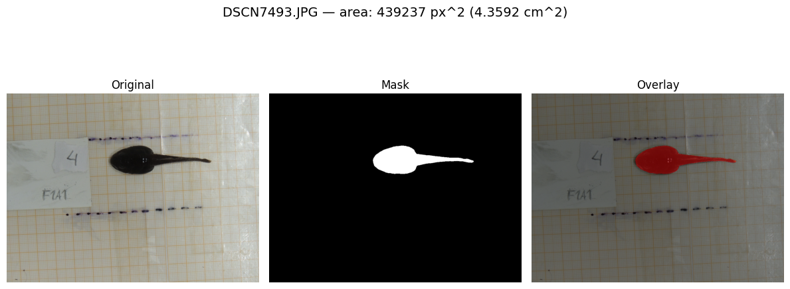
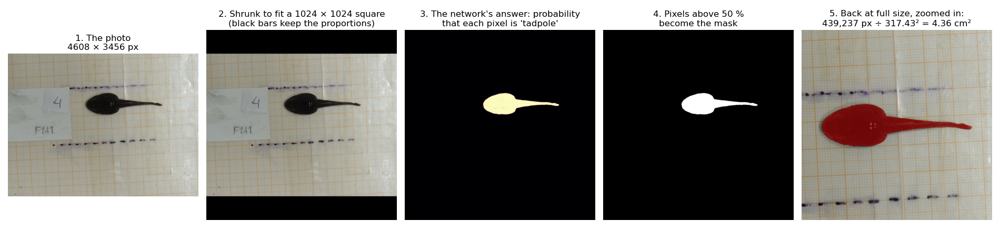
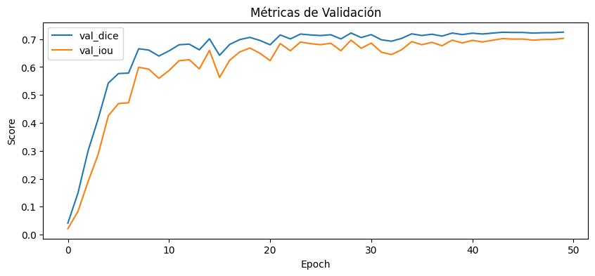
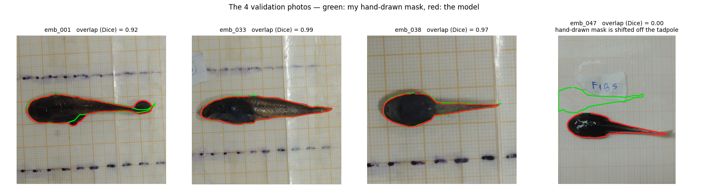
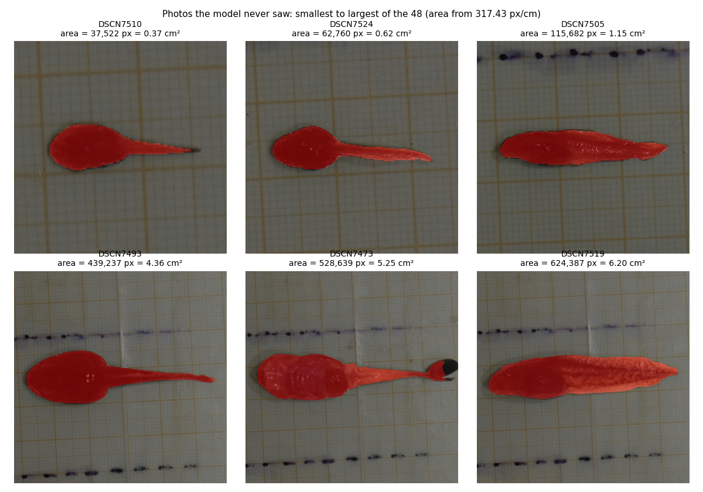

# tadpole-seg – measuring how big a tadpole is, from a photo

You give it a photo of a *Xenopus* tadpole lying next to a ruler (or graph paper), and it gives you back a **mask** that marks exactly which pixels are tadpole, and the tadpole's **area in cm²**.



## Why I built it, and what it is for

Size is one of the simplest things to compare between animals: bigger or smaller, faster or slower growth, one group against another. But measuring it by hand means tracing the outline of every tadpole in every photo, which is slow, tiring and a bit different every time you do it.

So I trained a small neural network to do the tracing. Once it works, measuring a new photo takes seconds, and the same photo always gives the same answer. It is meant for anyone who needs the **size of many tadpoles photographed in the same way** (same camera, same background, same distance), for example to compare groups or follow growth over time.

It is a research and portfolio project, not a finished measuring instrument: see "Things to keep in mind" below.

## How it works



1. **The photo.** My photos are 4608 × 3456 pixels, much bigger than what a network can digest at once.
2. **A square for the network.** The photo is shrunk, keeping its proportions, until it fits a 1024 × 1024 square; black bars fill the rest. Shrinking without stretching matters: a stretched tadpole would have a wrong area.
3. **The network decides pixel by pixel.** The model is a **U-Net**, a kind of network built for this job. It first *compresses* the image to understand what is in it (a dark, elongated shape on a pale background) and then *expands* it back to full detail, while keeping shortcuts to the fine details, so that the outline is sharp. For every pixel it answers with a probability: "how likely is this pixel to be tadpole?" (bright = very likely).
4. **From probabilities to a mask.** Pixels above 50 % become "tadpole", the rest "background".
5. **Back to the real size, and to centimetres.** The mask is stretched back to the original photo size and its pixels are counted. Dividing by the **scale of the photo** (how many pixels make one centimetre, read from the ruler) squared gives the area in cm²: here 439,237 px ÷ 317.43² = 4.36 cm².

*Why does the encoder part start with "knowledge" from other images?* The first half of the U-Net is an **EfficientNet-B0** that was already trained to recognise shapes and textures in millions of everyday photos (the ImageNet collection). I then **fine-tuned** the whole network on my tadpole photos. This is called transfer learning, and it is what makes it possible to learn this task from only a handful of annotated photos.

## How I made it

**The data.** Photos of tadpoles taken with the same camera setup. For some of them I drew the tadpole's outline by hand, which gives a *mask*: a black-and-white image in which white means tadpole. These masks are the "right answers" the network learns from. In a mask, the tadpole is only 0.15 % to 3.9 % of the picture, so the network has to find a small object in a big background.

**The training** (notebook `notebooks/train_unet_finetuning.ipynb`, run on a Google Colab GPU):

| | |
|---|---|
| Photos used | **18 photo + mask pairs**: 14 to learn from and 4 kept aside to check (a random split) |
| Network | U-Net with an EfficientNet-B0 encoder (`segmentation_models_pytorch`), starting from ImageNet weights |
| Input size | 1024 × 1024 |
| Variety added during training | random flips and turns, small shifts, zooms and rotations, a little blur and colour change, so that 14 photos behave like many more |
| What it tries to minimise | a mix of two measures (pixel-by-pixel error and overlap error). The overlap part is important because the tadpole is small, and a network that just says "background" everywhere would otherwise score well on the pixel error |
| Training | 50 rounds (epochs) over the photos, batch of 2, AdamW optimiser, learning rate lowered when progress stalls |
| Model kept | the round with the lowest error on the 4 check photos |

*(My folder holds a few more annotated photos than the 18 that this training run used: the notebook only picked up the masks saved as `.png`.)*



## How well does it work?

The curve above rises quickly and then stays at an overlap (Dice) of about **0.72**, which looks mediocre. When I looked at the four check photos one by one, the reason turned out to be in the data, not in the model:



*How to read the number (Dice).* It measures how much two outlines overlap: 1 means identical and 0 means no overlap at all.

| Check photo | Dice | Area, model | Area, hand-drawn | Difference |
|---|---|---|---|---|
| emb_001 | 0.92 | 4.22 cm² | 3.85 cm² | +9.4 % |
| emb_033 | 0.99 | 6.09 cm² | 6.15 cm² | −1.0 % |
| emb_038 | 0.97 | 1.58 cm² | 1.64 cm² | −3.7 % |
| emb_047 | **0.00** | 2.94 cm² | 2.92 cm² | +0.8 % |

In **emb_047 the hand-drawn mask sits next to the tadpole instead of on it**: the model outlines the tadpole correctly, but the "right answer" is displaced, so the overlap is zero. That single photo pulls the average of four from about 0.96 down to the 0.72 in the curve (3 × 0.96 ÷ 4 ≈ 0.72). I checked the alignment of the other hand-drawn masks (the tadpole is dark and the paper is pale, so a correct mask must be dark inside and pale around it) and this is the only one that is displaced.

What I take from this:
- On the three well-annotated photos the model reaches about **0.96 overlap**, and on all four photos its **area is within 10 %** of the hand-drawn one, which is the quantity the tool is for.
- Four photos are very few, and I also picked the best round using those same four, so these numbers are optimistic, not an independent test.
- I did not retrain after finding the displaced mask; I preferred to leave the project as it was and say so here.

## Photos the model had never seen

I also ran it on 48 more photos of the same kind that I never annotated. Here are six of them, from the smallest to the largest tadpole:



The areas of the 48 photos run from 0.37 to 6.20 cm² (median 1.84 cm²). There is no hand-drawn reference for them, so I can only judge them by eye, and they look right to me. Two details:
- In **DSCN7473** the dark piece at the end of the tail is the modelling clay used to hold the tadpole in place. It is not part of the animal, and the model correctly leaves it out of the mask.
- In 5 of the 48 masks there are extra small pieces besides the tadpole. In four of them these are under 2 % of the area; in **DSCN7527** the extra piece is about 13 %. I did not check what those pieces are.

## Things to keep in mind

- **Very little data:** 18 annotated photos for training and 4 to check. It is a proof of concept, not a robust model.
- **One photographic setup:** same camera, graph-paper background, similar distance. A different background, lighting or camera will probably need new annotated photos.
- **The area is only as good as the scale.** The value 317.43 px/cm comes from my own photos. If the camera is closer or farther, the scale changes: in the smallest samples above the grid squares look larger than in the others, so those photos were probably taken at another zoom or distance and would need their own scale. Always calibrate with a ruler in each photo setup.
- **The threshold (50 %) is not tuned.** I did not try other values.
- **Checked on few photos.** Beyond the four above, nothing is compared with a hand measurement.

## Install and use

```bash
pip install .
tadpole-seg --scale-px-per-cm 317.43 --input path/to/image_or_folder --output out/ --save --show
```
```python
import tadpole_seg as tps
res = tps.segment_tadpole(scale_px_per_cm=317.43, input_path="examples/tadpole.JPG",
                          return_visuals=True, save_outputs=False)
```
The trained model (about 25 MB) is included in the package. You can use another one with `checkpoint_path=` or the `TADPOLE_CKPT` environment variable. `--scale-px-per-cm` is the number of pixels that make one centimetre **in the original photo**.

## Built with

[PyTorch](https://pytorch.org), [segmentation_models_pytorch](https://github.com/qubvel-org/segmentation_models.pytorch) (U-Net), [timm](https://github.com/huggingface/pytorch-image-models) (EfficientNet-B0 with ImageNet weights) and Albumentations (training variety).

> **Note:** originally developed and run in Google Colab. Google-Drive mounting cells were removed, Drive paths were rewritten as relative paths and outputs were stripped (figures of the original run are in `assets/`). The paths/cleanup were **not re-executed** after this change, so expect to adjust paths.

## Author
Tiago Alejo Herrador — MIT licensed.
